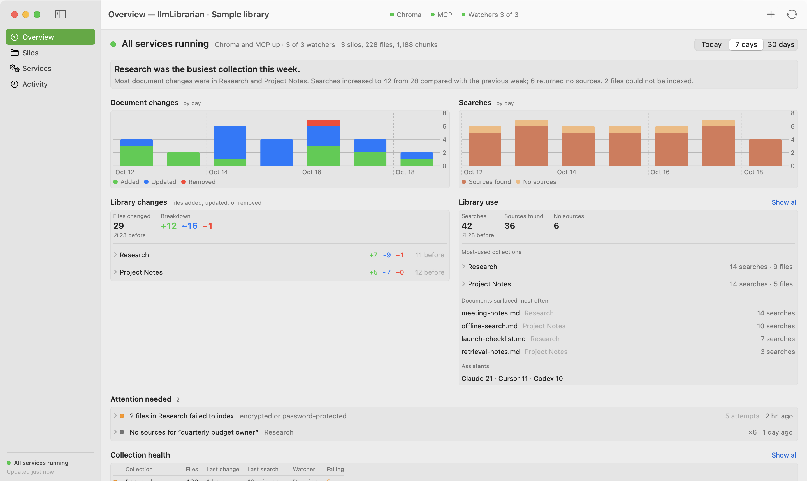
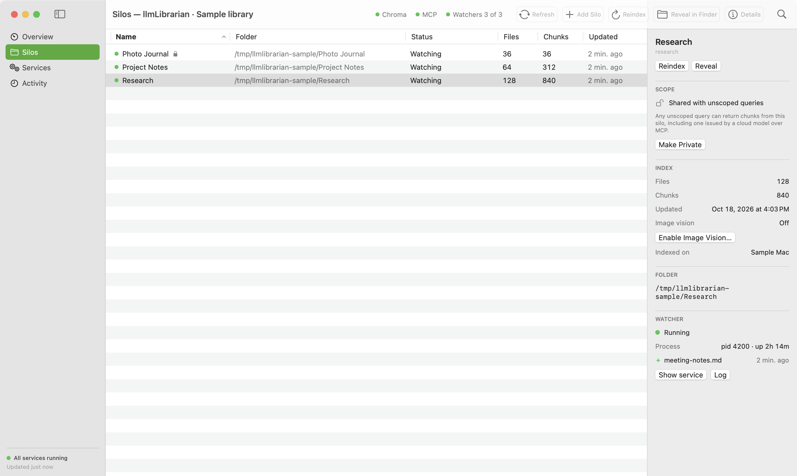
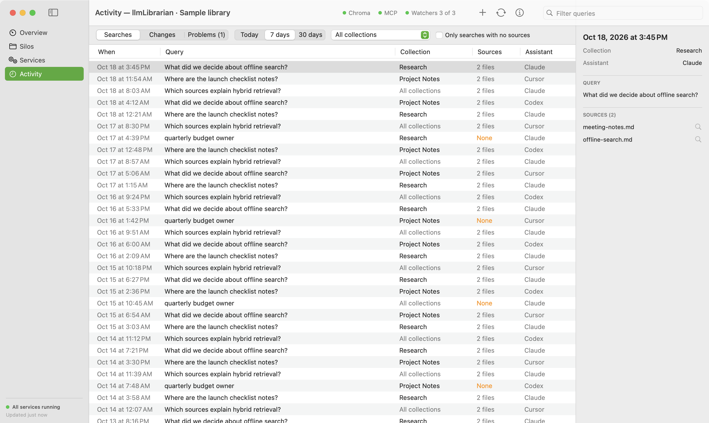

# llmLibrarian

**Ask questions of your own files** — notes, code, PDFs, journals — with answers grounded in what you actually saved, not in the model’s memory of the internet.

Your files and search index stay on your machine. You choose which folders become searchable; when a cloud assistant calls MCP, retrieved excerpts are sent to that assistant. An assistant (Cursor, Claude, etc.) can pull **cited chunks** from that index through a small **MCP server**, or you can ask in the terminal with **local Ollama** via `pal ask`.

## Native macOS app

See index health, manage searchable folders, control background services, and inspect
which assistant retrieved which sources. The app lives in the menu bar and supports
native File, Edit, View, Silo, Window, and Help commands.



*Actual app capture with synthetic sample data. Counts and service states illustrate the UI, not a benchmark.*

<details>
<summary>Folder controls and query provenance</summary>





</details>

The Mac app currently requires macOS 14+, Xcode Command Line Tools, and a configured
Python checkout. It is a source build, not a standalone signed installer:

```bash
macos/build.sh --install
```

See [Mac setup and screenshot workflow](macos/README.md). The engine and CLI also run
on Linux; the native status app is macOS-only.

---

## Why this exists

You already have the information — scattered across folders, exports, half-finished docs, and old PDFs. The hard part is not “having an LLM,” it’s **finding the right paragraph** when you need it.

| What you might do today | What breaks down |
|-------------------------|------------------|
| `grep` / file search | Only finds exact words, not “that thing I wrote about pricing last fall” |
| Paste files into chat | Huge, stale, and sends more than the question needs |
| Cloud “upload your drive” | You lose control of what’s indexed, when it updates, and what leaves your network |
| Hope the model “remembers” | It doesn’t have your disk; it guesses |

**Semantic search** (vector search) means: *find passages that mean similar things*, even when the wording differs. llmLibrarian builds that index **locally**, keeps a **registry of folders (silos)**, and returns **small, scored excerpts with file paths** so you or your agent can answer honestly: “here’s what your files say.”

This project is **personal infrastructure** — opinionated defaults for one person’s workflows first, not a generic team SaaS.

---

## What you get

1. **Index** — Point at a folder (`pal pull /path`). Supported types include text/code, PDF, Office files, ZIPs, and optional image paths. See `pal capabilities`.
2. **Retrieve** — Ask in meaning, not just keywords. Hybrid search (semantic + exact phrases), silo scoping, and intent-aware behavior (tax, file lists, “what’s in here?”, etc.).
3. **Answer** — Either:
   - **Cursor / MCP:** tools return **chunks + sources**; the **cloud model** you already use writes the reply, or
   - **Terminal:** `pal ask` runs retrieval + **local Ollama** in one step (private, no chat memory in the engine).

There is **no** built-in “the AI remembers you forever.” Each question uses **this query + what’s in the index now** — on purpose, so answers stay traceable.

---

## Two ways to use it (pick your comfort)

```text
┌─────────────────────────────────────┐     ┌─────────────────────────────────────┐
│  Cursor (or any MCP client)         │     │  Terminal                            │
│  • list_silos, query_personal_…     │     │  • pal pull /path                    │
│  • add_silo, trigger_reindex        │     │  • pal ask --in <silo> "question"    │
│  • Cloud model synthesizes answer   │     │  • Ollama answers locally (pal ask)  │
└─────────────────────────────────────┘     └─────────────────────────────────────┘
              │                                           │
              └─────────────────┬─────────────────────────┘
                                ▼
                    your index (my_brain_db)
                    + optional chroma run :8000
```

| Goal | Use |
|------|-----|
| Coding, agents, multi-step tasks | **MCP** in Cursor — see [docs/GUIDE.md](docs/GUIDE.md#cursor-and-mcp) |
| Quick private Q&A, scripting | **`pal ask`** |
| Build/maintain the index | **`pal pull`**, `pal ls --status` |

**Privacy in one line:** the **full corpus** stays local; **only retrieved chunks** go to a cloud model when you use MCP with a cloud host. `pal ask` keeps retrieval and answer on your machine.

**Private silos.** Some folders should not be reachable by a broad question at all. Mark one with `llmli private <silo> --yes` (or `pal private <silo> --yes`, or the lock toggle in the macOS app) and it is excluded from every unscoped query — it only answers when a caller names it with `--in <silo>` / `silo=<silo>`. The filter is applied in the query itself, not left to the calling model's judgement.

---

## Quick start

Install [uv](https://docs.astral.sh/uv/getting-started/installation/) and use Python
3.10–3.13. Install [Ollama](https://ollama.com/) if you want local answers.
From a fresh checkout:

```bash
git clone https://github.com/Phasm22/llmLibrarian.git
cd llmLibrarian
uv venv && source .venv/bin/activate
uv sync
ollama pull llama3.2:latest   # only needed for pal ask / llmli ask
```

To index standalone photos, install the optional image embedding stack:

```bash
uv sync --extra image
```

Photo questions use two stages: `query_personal_knowledge` searches the sibling
image-vector collection and returns candidate image paths; when a candidate has
only a deferred summary, call `ask_image` with that indexed path to inspect the
original pixels. Image dependency failures stop photo ingest before any index or
manifest writes, rather than registering a silo with silently skipped images.
The image extra also installs the HEIC/HEIF decoder required for those advertised
formats; base Pillow alone cannot open them.

Index a folder (silo name = folder basename unless you override):

```bash
pal pull ~/Documents/my-project
pal ls
pal ask --in my-project "what is this repo about?"
```

For **Cursor**, run the MCP server (`./scripts/run_mcp_http.sh`; see [docs/CHROMA_AND_STACK.md](docs/CHROMA_AND_STACK.md#server-mode-the-supported-deployment)) and connect to `http://127.0.0.1:8765`. Call `list_silos` before trusting retrieval.

**Secrets:** do not commit API keys. Prefer `~/.config/llmLibrarian/.llmlibrarian.env` (mode `600`). Details in [docs/GUIDE.md](docs/GUIDE.md#configuration).

---

## Everyday workflow

```bash
pal pull /path/to/folder          # index (or refresh)
pal ls --status                   # silos + daemon health
pal ask --in <silo> "…"           # local Q&A
pal inspect <silo> --top 20       # coverage / chunk counts per file
```

**Wide question** (explore a silo): “what kinds of docs are here?” “themes last year?”  
**Narrow question** (one fact): “where is X defined?” “2023 total tax line?” — use `--in <silo>` and concrete nouns.

```bash
pal ask --in <silo> "what was I focused on in Q3?"
pal ask --in <silo> "where is chroma_shared_lock used?"
pal ask in <silo> "W-2 employer name"    # shorthand for --in
```

Cross-silo only when you mean it:

```bash
pal ask --unified "what shows up in more than one project?"
```

More examples: [docs/GUIDE.md](docs/GUIDE.md#asking-good-questions).

---

## Keeping it healthy

```bash
pal ls --status
llmli repair-ladder              # read-only diagnostics
llmli repair <silo> --yes        # wipe + re-index one silo if Chroma errors (--dry-run to preview)
```

If MCP and CLI both run, use **Chroma server mode** (one `chroma run`, everyone else HTTP) — [docs/CHROMA_AND_STACK.md](docs/CHROMA_AND_STACK.md).

Watchers (`pal pull --watch`) keep silos fresh; `trigger_reindex` via MCP after big edits.

---

## Background services

On macOS, use `pal chroma`, `pal mcp`, and `pal daemon` to manage launchd services;
the native app shows their status and exposes start/restart controls. For Linux
systemd setup and the maintainer's optional `pc-stacks` wrapper, see
[Chroma and stack setup](docs/CHROMA_AND_STACK.md). `pc-stacks` is host-specific,
not a prerequisite shipped with this project.

---

## When something looks wrong

| Symptom | Try |
|---------|-----|
| Vague or empty answers | `pal inspect <silo>`; narrow with `--in`; reindex if stale (`pal ls --status`) |
| `Error finding id` / Chroma weirdness | `llmli repair <silo> --yes` (or `--dry-run` first) |
| MCP returns 0 chunks but silo has chunks | `health()` + `list_silos` — index/tool issue, not “no data” |
| Scan PDFs with no text | OCR path depends on OS; see [docs/GUIDE.md](docs/GUIDE.md#troubleshooting) |

---

## Commands at a glance

| Command | Role |
|---------|------|
| `pal` | Day-to-day: pull, ask, ls, daemon, chroma service |
| `llmli` | Engine/scripting: add, ask, repair, rehydrate, log |
| MCP tools | Agent retrieval + ingest (`query_personal_knowledge`, `add_silo`, …) |

---

## Further reading

| Doc | For |
|-----|-----|
| [docs/GUIDE.md](docs/GUIDE.md) | Narrative guide: why, workflows, MCP vs terminal, privacy |
| [docs/CHROMA_AND_STACK.md](docs/CHROMA_AND_STACK.md) | Chroma server mode, concurrency, systemd, **pc-stacks** |
| [AGENTS.md](AGENTS.md) | Coding agents: MCP checklist, **pc-stacks**, tool names |
| [CLAUDE.md](CLAUDE.md) | Claude Code: dev commands + architecture map |
| [docs/TECH.md](docs/TECH.md) | Behavior contracts (intent, pull, ask) |
| [docs/orchestration-matrix.md](docs/orchestration-matrix.md) | CLI vs MCP entry points |
| [SECURITY_AND_TESTING.md](SECURITY_AND_TESTING.md) | Security and tests |
